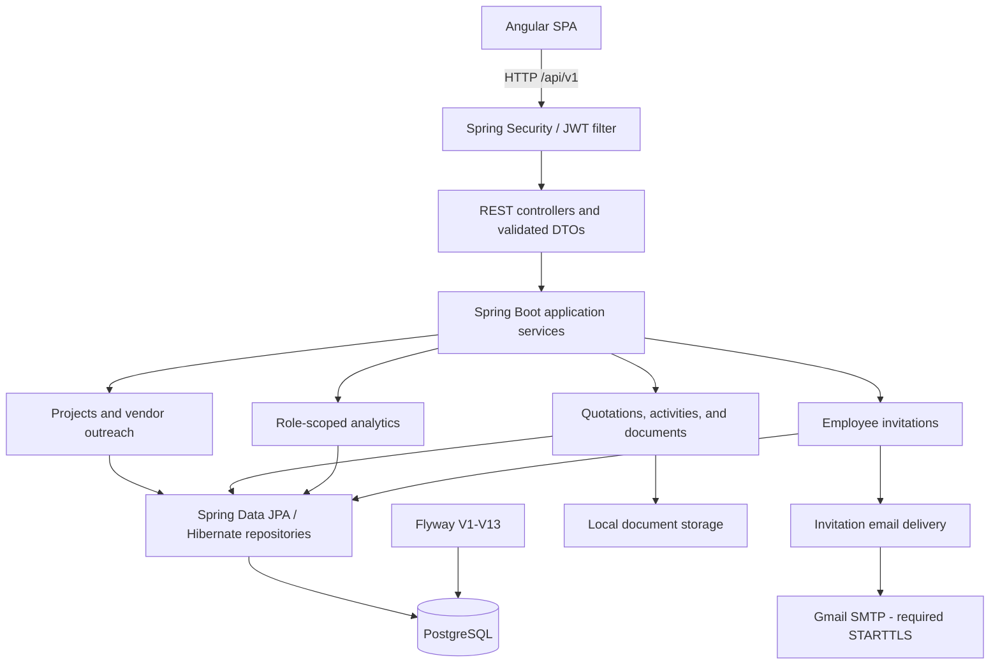

# Orqestra

**Project & Vendor Platform**

*Every project, in harmony.*

A full-stack B2B workspace for coordinating client projects, vendor outreach, quotations, documents, and employee responsibilities. Built with Spring Boot, Angular, and PostgreSQL, with server-side authorization throughout the project workflow.

## Live Demo

**[Launch Live Demo](https://orqestra-showcase.pages.dev)**

Explore the public **read-only showcase**. Admin, Manager, and Associate demo credentials are displayed on the login page.

### Interactive Login Experience


An immersive login experience featuring a Three.js animated background, responsive parallax, and interactive glass effects.

### Operations Dashboard


Real-time operational insights into projects, vendor outreach, quotations, and team workloads, with role-based access controls.

## Run the Full Version Locally (Docker)

Run the **full, locally editable application** from the `main` branch with Docker to create, edit, and manage records.

Only **Docker Desktop with Linux containers and Compose v2.24+** is required. No local Java, Node.js, PostgreSQL, or Gmail account is needed.

```bash
git clone https://github.com/youssefsaoud/orqestra.git
cd orqestra
docker compose --env-file .env.demo -f docker-compose.demo.yml up --build -d --wait
```

Open **http://localhost:4201**. The first build takes longer while images and dependencies download.

| Role | Email | Password |
| --- | --- | --- |
| Admin | admin@orqestra.demo | OrqestraDemo2026! |
| Manager | manager@orqestra.demo | OrqestraDemo2026! |
| Associate | associate@orqestra.demo | OrqestraDemo2026! |

Admin can explore all operational data and Team Management. Manager can manage projects, vendors, and quotations, but cannot administer invitations. Associate sees assigned projects and role-scoped analytics, documents, and follow-ups.

On a fresh database, Demo Mode creates 24 projects, 30 vendor organizations, 16 client organizations (four have both roles), 96 vendor assignments, 72 quotation revisions, 144 activities, 42 contacts, and three downloadable sample documents. Three active Associates have varied workloads. The two additional synthetic staff accounts receive unknown random passwords, not the public demo password, and have no documented shared login credentials. Existing demo databases retain employee edits and original assignments; the new staff and four additional projects are added without resetting records.

The committed `.env.demo` contains only public local-demo settings. This command does not load `.env.local`, connect to native `crm_dev`, or reuse normal Docker database/upload volumes. SMTP is disabled; Admin invitation previews are available without sending email. These public credentials work only with the explicitly enabled demo configuration. **Never deploy Demo Mode publicly or use its credentials in production.** Published ports bind to `127.0.0.1`.

```bash
# Stop without deleting records or documents
docker compose --env-file .env.demo -f docker-compose.demo.yml stop

# Start again with the same persistent data
docker compose --env-file .env.demo -f docker-compose.demo.yml up -d --wait
```

Restarts preserve account passwords and recruiter edits without duplicating seed records. The demo generates a fresh JWT signing key when the backend starts, so sign in again after a backend restart. Production/demo profile conflicts fail startup before database initialization.

The default volumes are `orqestra-demo_demo_postgres_data` and `orqestra-demo_demo_uploads`. They are separate from `orqestra_crm_postgres_data` and `orqestra_crm_uploads`; do not delete volumes to restart the demo. Demo and normal Docker modes use the same default ports, so stop the other stack first or set `ORQ_FRONTEND_PORT` / `ORQ_BACKEND_PORT` in your shell to unused ports.

Demo API health: http://localhost:8081/api/v1/health. Local Swagger UI: http://localhost:8081/swagger-ui/index.html. Flyway applies V1-V13 automatically. Analytics remain server-side role-scoped, and USD, EUR, and MAD totals are never added together without conversion.

## Overview

Orqestra brings project delivery and supplier coordination into one workspace. Teams can connect a client request to a project, assign an associate, follow vendor responses, compare quotation revisions, and keep communication and supporting documents alongside the work.

Clients and vendors share one organization model: a company can have either role or both. Existing contacts, leads, opportunities, and sales analytics remain available through the secondary Sales CRM navigation.

## Core Features

| Area | Implemented capabilities |
| --- | --- |
| **Projects** | Create, search, filter, and paginate projects. Server-side status counters follow the current search across all statuses and respect project visibility. Track reference, client, category, location, deadline, budget, currency, assigned associate, status, Scope of Work, and notes. Summary shortcuts open vendor, quotation, and document sections; project history shows the recorded creation and last-update timestamps, not a full audit trail. |
| **Vendors** | Search the vendor directory, associate vendors with projects, assign responsible associates, update outreach status, and track contact dates, follow-ups, and notes. Organization lists and details show separate client/vendor project counts, restricted to distinct projects visible to the current user. |
| **Quotations** | Record quotations from multiple vendors, retain numbered revisions, compare amounts and currencies, and select or replace the winning quotation transactionally. Quote updates can mark vendor outreach as Quote Received. |
| **Activities** | Record notes, calls, emails, meetings, and follow-ups. View project communication timelines and upcoming or overdue vendor follow-ups. |
| **Documents** | Upload project files and quotation attachments up to 10 MB, list file metadata, and download through authorized API endpoints. Files use local filesystem storage; metadata is persisted in PostgreSQL. |
| **Analytics** | ECharts visualizations for project status, vendor outreach, quotation trends, and associate workload. Date-range, associate, and currency controls where applicable; unlike currencies are kept separate. |
| **Authentication** | JWT login, BCrypt password hashing, protected Angular routes, and Spring Security authorization. Associates see assigned-project data and role-scoped analytics. |
| **Employee onboarding** | Admin-only Team Management, Manager/Associate invitations, Gmail SMTP emails, password setup through single-use activation links, expiry, resend, revocation, and delivery failure tracking. |

The interface uses a shared dark design system, Manrope headings, Geist inputs and body text, and a lazy-loaded Three.js login scene with reduced-motion and WebGL fallbacks.

Financial values use two decimal places and tabular figures, with compact EUR (blue), MAD (green), and USD (neutral) badges. Other currencies use a neutral fallback. Quotation revisions remain individual submissions; amounts in different currencies are never combined without conversion. Relationship counts do not multiply when quotations have multiple revisions.

## Screenshots

Captured from the running application using synthetic development and isolated Docker demo records. No live customer data is shown.

| Projects | Project Details |
| --- | --- |
|  |  |

| Vendors | Team Management |
| --- | --- |
|  |  |

## Tech Stack

| Layer | Technologies |
| --- | --- |
| Backend | Java 21, Spring Boot 3.3.5, Spring Security, Spring Data JPA / Hibernate, Jakarta Validation |
| Persistence | PostgreSQL, Flyway migrations V1-V13 |
| Frontend | Angular 16.2.12, TypeScript 5.1.6, Angular Router, Reactive Forms, RxJS |
| Visualization | ECharts 6.1.0, Three.js 0.186.1 |
| Typography | Locally bundled Manrope and Geist variable fonts |
| Email and security | Spring Boot Mail, Gmail SMTP with required STARTTLS, JWT, BCrypt |
| Build and testing | Maven, pnpm, JUnit 5, Spring Boot Test, Mockito, Jasmine, Karma |
| Source control | Git and GitHub |

## Architecture

The backend is a modular monolith organized by business capability. REST controllers accept validated DTOs; Spring Security checks authentication, and application services enforce ownership and role rules. Spring Data repositories persist the relational model through Hibernate.

The Angular application is organized by feature, with shared authentication services, route guards, and an HTTP interceptor. Dashboard and authentication experiences are lazy-loaded.



Invitation hashes and lifecycle state are persisted before email delivery. SMTP runs outside the invitation transaction; failures remain visible for safe retry. Account creation and token consumption execute atomically with a database row lock.

## Business Workflow

```mermaid
flowchart LR
    Request["Client request"] --> Project["Create project and Scope of Work"]
    Project --> Associate["Assign associate"]
    Associate --> Outreach["Assign vendors and track outreach"]
    Outreach --> SOW["Record SOW Sent status"]
    SOW --> Quotes["Record quotations and revisions"]
    Quotes --> Selection["Admin or Manager selects quotation"]
    Selection --> Progress["Track project progress"]
    Progress --> Updates["Activities, follow-ups, and documents"]
```



This diagram describes user-driven work, not an automatic approval engine. SOW Sent is an outreach status; project progress and outreach dates are maintained by users. Quotation recording and selection apply the implemented quotation/outreach status updates.

## Role-Based Permissions

Authorization is enforced in backend services and the Spring Security filter chain. Angular visibility and route guards provide an additional UI boundary.

| Capability | Admin | Manager | Associate (`SALES_REP`) |
| --- | --- | --- | --- |
| Browse client/vendor directories | Yes | Yes | Yes |
| Create/update organizations | Yes | Yes | No |
| Delete organizations | Yes, subject to relationship checks | No | No |
| View projects and operational analytics | Organization-wide | Organization-wide | Assigned projects / own scope |
| Create/delete projects; add/remove project vendors | Yes | Yes | No |
| Update vendor outreach and record quotations | Yes | Yes | Within assigned projects; cannot reassign vendor work |
| Select or replace winning quotation | Yes | Yes | No |
| Access project documents and activities | Authorized organization-wide scope | Authorized organization-wide scope | Assigned-project scope |
| List employees; invite, resend, revoke | Yes | No | No |

## Local Development

### Prerequisites

- JDK 21 and Maven 3.9+ (`JAVA_HOME` must point to JDK 21)
- Node.js 18.x or 20.x and pnpm 10 (Docker uses 10.28.2); the package declares Node `>=16.14.0 <21.0.0`
- PostgreSQL, with version 16 matching the included Compose database image

### 1. Clone and Configure PostgreSQL

```bash
git clone https://github.com/youssefsaoud/orqestra.git
cd orqestra
```

Run as a PostgreSQL administrator on a fresh local installation, choosing your own password:

```sql
CREATE USER crm_app WITH PASSWORD 'replace-with-your-local-password';
CREATE DATABASE crm_dev OWNER crm_app;
```

Use an existing database/user when already configured.

### 2. Configure the Backend

Use [`.env.example`](.env.example) as the configuration reference. In a fresh checkout, create an ignored root `.env.local`:

```powershell
# PowerShell
if (!(Test-Path .env.local)) { Copy-Item .env.example .env.local }
```

```bash
# macOS / Linux
cp -n .env.example .env.local
```

Configure these keys once in `.env.local`:

| Key | Local configuration |
| --- | --- |
| `CRM_DB_URL` | `jdbc:postgresql://localhost:5432/crm_dev` |
| `CRM_DB_USERNAME`, `CRM_DB_PASSWORD` | Your database user and password |
| `CRM_JWT_SECRET` | A securely generated signing secret of at least 32 characters |
| `CRM_CORS_ALLOWED_ORIGIN` | `http://localhost:4200` |
| `CRM_BOOTSTRAP_ADMIN_ENABLED` | `true` only to create the first development Admin when none exists |
| `CRM_BOOTSTRAP_ADMIN_EMAIL`, `CRM_BOOTSTRAP_ADMIN_PASSWORD` | Your chosen initial Admin credentials |
| `FRONTEND_BASE_URL` | `http://localhost:4200` for local activation links |

The default `dev` profile **explicitly imports** `.env.local` as a Spring properties file from the current working directory or its parent. Launching from `backend/` therefore loads the root file. Use plain `KEY=value` entries without shell `export` prefixes or surrounding quotes. Process environment variables are also supported. Other profiles must receive configuration through environment variables or Spring configuration.

Disable Admin bootstrap after the initial setup. No public signup is available.

### 3. Run the Application

In one terminal, from the repository root:

```bash
cd backend
mvn spring-boot:run
```

Flyway applies migrations automatically, and Hibernate validates the schema. Do not edit migrations already applied to a database.

In another terminal:

```bash
cd frontend
pnpm install --frozen-lockfile
pnpm start
```

| Service | URL |
| --- | --- |
| Angular application | http://localhost:4200 |
| Spring Boot API | http://localhost:8080/api/v1 |
| Public API health check | http://localhost:8080/api/v1/health |

Angular's development proxy forwards `/api` requests to port 8080. The configured API URL lives in `frontend/src/environments/`.

Uploaded files default to `${user.home}/.crm/uploads`. Override `crm.documents.storage-path` through Spring configuration when needed, and preserve that directory alongside the database.

### 4. Configure Invitations

Set `SMTP_USERNAME` to your dedicated Gmail sender and `SMTP_PASSWORD` to its Google app password. The backend uses `smtp.gmail.com:587`, authentication, required STARTTLS, certificate verification, and network timeouts.

- `INVITATION_DELIVERY_MODE=smtp` enables real email submission.
- `INVITATION_TTL_HOURS=24` sets the default link lifetime.
- For local preview without sending mail, use `INVITATION_DELIVERY_MODE=preview` and `INVITATION_PREVIEW_ENABLED=true` with the `dev` profile. The Admin-only `GET /api/v1/admin/invitations/{id}/preview` endpoint serves an ephemeral preview.
- Admins invite Managers or Associates from **Team**. Resending rotates the token; revocation invalidates the invitation.
- SMTP submission is recorded separately from acceptance and does not guarantee inbox delivery.

Keep `.env.local` and credentials out of Git. Invitation endpoints use request limits, and PostgreSQL stores token hashes rather than plaintext tokens.

### Local API Documentation

With the `dev` profile, open [Swagger UI](http://localhost:8080/swagger-ui/index.html). The OpenAPI JSON is available at [`/v3/api-docs`](http://localhost:8080/v3/api-docs).

Use **Authentication > POST /api/v1/auth/login** with your local account, then paste the returned `accessToken` into **Authorize** without the `Bearer` prefix. Secured operations send the JWT automatically; existing role and ownership rules still apply. Try read-only requests first: writes affect the configured database. Do not share tokens or credentials.

Documentation is disabled outside development, and documentation routes are denied outside the `dev` profile. Authorization is not persisted by Swagger UI. Invitation previews are excluded from the API catalog.

### Docker Compose (Private Development)

Requires Docker Desktop running Linux containers with Docker Compose v2.24+ (or a compatible Docker Engine/Compose installation). Host Java, Maven, Node, and PostgreSQL are not required for this route.

For the ready-to-explore synthetic dataset and public demo accounts, use **Try Orqestra Locally** above instead. The following configuration is independent, uses private credentials, and does not enable recruiter demo seeding.

From a fresh clone, create `.env.local` using the guarded copy command above. Set a private `CRM_DB_PASSWORD`, a random `CRM_JWT_SECRET` of at least 32 characters, and your own `CRM_BOOTSTRAP_ADMIN_EMAIL` and `CRM_BOOTSTRAP_ADMIN_PASSWORD` (at least 12 characters). Set `CRM_BOOTSTRAP_ADMIN_ENABLED=true` for the first startup of the empty container database. The container rejects short JWT secrets or incomplete/short bootstrap credentials. Never use the example placeholders as passwords or publish this file.

```bash
docker compose --env-file .env.local config --quiet
docker compose --env-file .env.local up --build -d --wait
docker compose --env-file .env.local ps
```

For the shorter `docker compose up --build` form, first set `COMPOSE_ENV_FILES=.env.local` in your shell (`$env:COMPOSE_ENV_FILES='.env.local'` in PowerShell, or `export COMPOSE_ENV_FILES=.env.local` in bash). Compose does not automatically read `.env.local` without this setting or `--env-file`.

| Service | Local address | Container port |
| --- | --- | --- |
| Angular / nginx | http://localhost:4201 | 80 |
| Spring Boot API | http://localhost:8081/api/v1 | 8080 |
| API health | http://localhost:8081/api/v1/health | 8080 |
| Swagger UI | http://localhost:8081/swagger-ui/index.html | 8080 |
| PostgreSQL | Internal Compose network only | 5432 |

Published ports bind only to `127.0.0.1`. Change `ORQ_FRONTEND_PORT` or `ORQ_BACKEND_PORT` if needed. nginx forwards same-origin `/api` requests to the backend, so no frontend secrets or build-time API credentials are needed. Compose sets CORS and invitation activation URLs to its frontend port, overriding native-development URLs in `.env.local`.

PostgreSQL must become healthy before the backend starts; the frontend waits for backend health. Flyway applies migrations V1-V13 on an empty container database and validates them on later starts. Hibernate validates the resulting schema. Compose uses the `dev` profile with demo seeding disabled; Swagger is local-only through the loopback binding. It does not connect to or reset your native `crm_dev` database.

Sign in with the private Admin account chosen above. After it exists, set `CRM_BOOTSTRAP_ADMIN_ENABLED=false` in your local configuration and rerun `up -d --wait`. Bootstrap does not overwrite an existing Admin or reset its password.

Email is optional for startup. Leave `SMTP_USERNAME` and `SMTP_PASSWORD` empty until invitations are needed, then configure the dedicated Gmail sender and app password described above. Compose forwards these only to the backend at runtime. Invitation delivery requires working SMTP, or explicitly enabled development preview mode; no email is sent on startup.

| Named volume (default project `orqestra`) | Purpose | Container path |
| --- | --- | --- |
| `orqestra_crm_postgres_data` | PostgreSQL records and Flyway history | `/var/lib/postgresql/data` |
| `orqestra_crm_uploads` | Uploaded project documents and quotation attachments | `/app/uploads` |

Compose sets `CRM_DOCUMENTS_STORAGE_PATH=/app/uploads` to match the upload volume. Changing database passwords in `.env.local` does not change credentials in an already-initialized PostgreSQL volume. Keep the original values, or rotate them deliberately inside PostgreSQL. Back up the database and upload volume together.

```bash
# Stop containers without removing them or their data
docker compose --env-file .env.local stop

# Start again, preserving records and uploaded files
docker compose --env-file .env.local up -d --wait

# Remove this project's containers and networks; retain named volumes
docker compose --env-file .env.local down
```

Do not remove the named volumes when you need to retain data. This is a local-development setup, not a public deployment configuration.

## Testing

Run backend tests from `backend/`:

```bash
mvn test
```

The suite includes Spring security tests and invitation lifecycle tests using real HTTP requests and temporary records. A local `crm_dev` database must be available and configured. Routine email tests use mocked delivery; the SMTP connectivity test is opt-in.

Run frontend tests and the production build from `frontend/`:

```bash
pnpm exec ng test --watch=false --browsers=ChromeHeadless
pnpm exec ng build --configuration production
```

Karma requires an installed Chromium browser. To use Microsoft Edge on Windows:

```powershell
$env:CHROME_BIN = "C:\Program Files (x86)\Microsoft\Edge\Application\msedge.exe"
pnpm exec ng test --watch=false --browsers=ChromeHeadless
```

Frontend coverage includes authentication routing, Admin-only navigation, invitation forms, activation states, currency rendering, search-aware status counters, project-tab shortcuts, recorded timestamps, and organization relationship indicators. Backend coverage includes validation, ownership, quotation workflows, invitation expiry/revocation/reuse, concurrent acceptance, token rotation, delivery failure handling, demo configuration safety, BCrypt account creation, preservation of existing demo passwords, inactive-account JWT rejection, role-scoped aggregates, and upload storage validation.

## Project Status

**License: GNU AGPLv3. Copyright © 2026 Youssef Saoud. See LICENSE for terms.**

Orqestra is an actively developed, functional portfolio project. Project/vendor workflows, operational analytics, and employee onboarding run locally with PostgreSQL persistence. Local development is the primary demonstration workflow.
